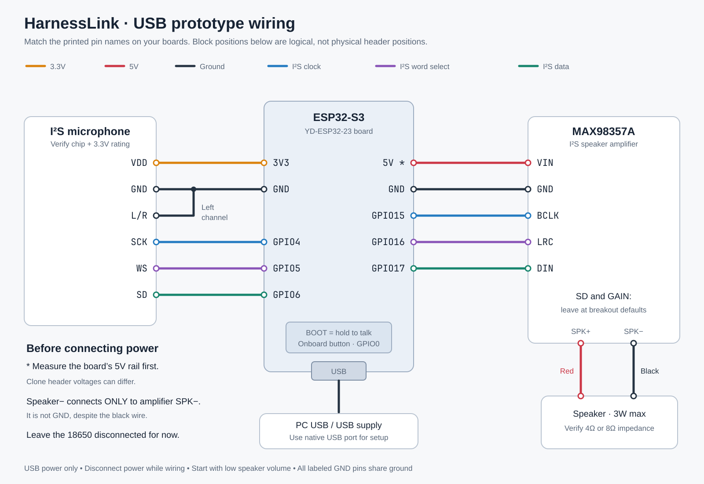
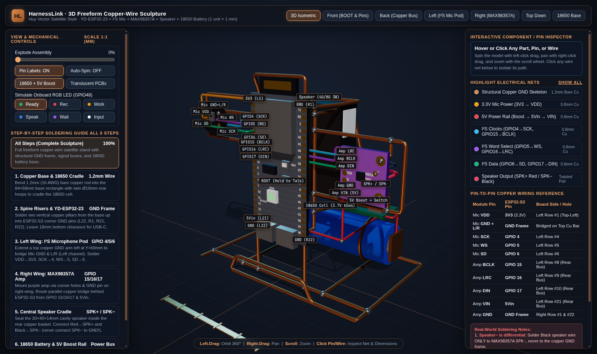

# HarnessLink

A USB-powered, push-to-talk Wi-Fi terminal for a dedicated Codex conversation on this PC.
Hold the ESP32-S3 BOOT button to speak English; release it to submit. The PC runs local
speech recognition, Codex, and local speech synthesis. The device plays a brief final reply.

**Current status:** source implementation and automated bridge tests are available.
Firmware has not been compiled or flashed, and physical audio has not been verified.
This Codex environment cannot access `/dev/ttyACM0`, open network sockets, or download
packages; ESP-IDF is absent. Linux sysfs does detect an Espressif 303a:4001 CDC device.
Use a normal terminal on this PC for the setup and hardware steps below.

## Hardware wiring

Disconnect power while wiring. The photos show a YD-ESP32-23 / ESP32-S3 board,
an I²S microphone breakout, MAX98357A amplifier, and speaker. The microphone chip marking
cannot be read reliably; verify its model and supply rating before applying power.
The default microphone configuration expects Philips I²S, 24-bit data in 32-bit stereo slots,
left channel. It is configurable in `idf.py menuconfig` → HarnessLink hardware.



[Open the scalable wiring diagram](docs/images/wiring.svg). Connections follow printed
pin names; the diagram does not represent physical header positions.

| Part pin | ESP32-S3 connection |
|---|---|
| Microphone VDD | 3V3, after verifying microphone rating |
| Microphone GND | GND |
| Microphone SCK | GPIO4 |
| Microphone WS | GPIO5 |
| Microphone SD | GPIO6 |
| Microphone L/R | GND for left channel, if supported by its datasheet |
| MAX98357A VIN | Verified USB 5V rail |
| MAX98357A GND | GND |
| MAX98357A BCLK | GPIO15 |
| MAX98357A LRC | GPIO16 |
| MAX98357A DIN | GPIO17 |
| MAX98357A SD | Leave at breakout default; verify its enable bias if silent |
| MAX98357A GAIN | Leave at breakout default initially |
| Speaker red / black | Amplifier speaker+ / speaker− |

Speaker− is an amplifier output: do not connect it to GND. Verify the speaker impedance
(normally 4Ω or 8Ω for this amplifier) and stay below its 3W rating. Start with the supplied
low playback level. The amplifier can exceed 3W into 4Ω at 5V; gain and digital volume do
not establish a calibrated power limit. Verify clean output before increasing volume.
Measure the board's 5V header rail; clone board layouts can differ. Keep audio wiring short,
share ground, and use a reliable USB data cable and supply. If supply dips cause resets,
check wiring and decoupling before raising volume.

Use USB power only for this milestone. There is no confirmed 18650 charging/protection
circuit among these parts. Do not connect a bare cell to 3V3 or assume the 5V input will
operate reliably across the cell's voltage range. Battery power is a subsequent design.

### 3D Freeform Copper-Wire Sculpture & Build Guide

To inspect the physical 1:1 millimeter-scale freeform copper-wire standoff build (including the structural `GND` skeleton, parallel rear I²S copper bus, speaker cradle, and 18650 battery + 5V boost counterweight base) from any angle in your browser, open [`docs/model-3d.html`](docs/model-3d.html):



## Install and flash

From a normal PC terminal:

```bash
cd /home/shawn/CODE.LCL/HarnessLink
bash tools/setup.sh
bash tools/install-idf.sh
ls -l /dev/serial/by-id/
bash tools/build-flash.sh /dev/ttyACM0
```

`setup.sh` uses `uv` and Python 3.11, installs dependencies into `.venv`, generates a private
device token, and downloads English speech models. Speech runs locally after these downloads;
Codex itself still needs its normal network access and login. `install-idf.sh` installs
ESP-IDF 5.5.1 and the ESP32-S3 tools under the ignored `.tools` directory. The host needs
Espressif's Linux prerequisites (Git, CMake, Ninja, a C/C++ compiler, Python and development
headers); install missing host packages through your usual system package manager.

The flash script identifies chip/flash, builds for ESP32-S3 with a conservative 4 MB flash
profile, then fully erases and flashes. It does not use PSRAM. Compilation must succeed
before erasure. If the port differs after flashing, identify it again. Prefer the USB port
marked USB / native USB for both flashing and provisioning; firmware console output uses
USB Serial/JTAG. The COM port can flash through UART but is not the firmware provisioning console.

If normal flashing cannot connect, hold BOOT, tap RST, release BOOT, and retry. Release
BOOT before normal reset; holding it at boot enters the ROM download loader.

## Provision Wi-Fi

Connect the PC and device to the same LAN; the ESP32 needs a 2.4 GHz Wi-Fi network.
Find the PC's LAN IPv4 address with `ip -4 addr`. Then replace the example IP below:

```bash
.venv/bin/harnesslink provision --port /dev/ttyACM0 --bridge ws://192.168.1.100:8765
```

The command asks for the SSID and a hidden password, sends settings over USB, and waits
for `HARNESSLINK_CONFIGURED`. Settings persist in the device's NVS; provisioning restarts it.
Keep serial monitors closed during provisioning. The firmware does not echo credentials.
Credentials are stored unencrypted on the device for this prototype.

The token in `.state/device-token` must remain the same for provisioning and bridge operation.
If it is replaced, reprovision the device. Keep `.state`, models, and credentials out of source control.

## Prove hardware before using Codex

First capture the microphone without invoking speech models or Codex:

```bash
.venv/bin/harnesslink serve --capture .state/mic-check.wav
```

Hold BOOT, say a short sentence, release it, then play `.state/mic-check.wav` on the PC
with `ffplay -autoexit .state/mic-check.wav`. Stop the bridge with Ctrl-C.
Check intelligibility, channel selection and clipping. If necessary change microphone
channel/shift in menuconfig and rebuild/flash **without erasure** using `idf.py -p PORT flash`.
Reducing microphone shift increases input gain; do not guess the chip format from silence alone.

Next run the quiet speaker test:

```bash
.venv/bin/harnesslink serve --tone
```

It plays a quiet 440 Hz tone once per authenticated connection; stop the bridge after hearing
it. This requires no Codex login or speech models. If it is silent, check amplifier enable,
power, pin labels, speaker wiring and impedance before changing volume.

## Talk to Codex

```bash
.venv/bin/harnesslink doctor
.venv/bin/harnesslink serve
```

Keep the terminal open for approvals and clarification questions. Hold BOOT to record;
release to submit. Recording stops at 60 seconds. Press BOOT during a spoken reply to stop
playback and begin a new utterance. During active work, recording waits until the bridge
has confirmed interruption. Interruption does not roll back commands already executed.

| LED | Meaning |
|---|---|
| Dim purple | Disconnected or not configured |
| Green | Ready |
| Purple | Waiting for previous work to stop / recording acknowledgment |
| Red | Recording; a brief red indication also signals an error or recording limit |
| Amber | Transcribing, Codex working, or synthesizing |
| Blue | Speaking |
| White | Needs input in the PC terminal |

The RGB GPIO defaults to 48; verify it for your board revision. Hardware pins and microphone
format can be changed in menuconfig. Text and full Codex events are saved to
`.state/transcript.jsonl`; the persistent thread ID and working directory are in
`.state/thread.json`. Normal mode does not save microphone audio.

Change the project with `serve --cwd /absolute/project/path`. Use a separate state directory
for a separate conversation: `harnesslink --state /private/path serve --cwd /project`.
Provision the device using the same `--state`. A saved conversation will not silently switch
working directories. Use `--codex /absolute/path/to/codex` if your version-manager shim fails.

The bridge preserves Codex's configured sandbox and approval policy. `y` accepts a displayed
action once; other responses decline it. Additional permission-profile grants and connector
elicitations are declined by this first version. If interrupted work cannot be confirmed
stopped, the bridge blocks new commands; inspect that Codex thread on the PC before restarting.
It never automatically retries a possibly executed command.

This prototype uses a token over `ws://` on a trusted home LAN. Wi-Fi audio and the token
are not encrypted at the application layer. Do not expose port 8765 to the internet.
The PC firewall must permit the device to reach the bridge on the LAN.

## Validation

```bash
bash tools/check.sh
```

Tests use real subprocess pipes for the Codex RPC client and an in-memory device transport
for audio sessions. They cover silence/DC rejection, limits, authentication, playback pacing,
stale acknowledgments, interruption, persistent threads, approvals, failed turns, and process
death. A host C test checks button debounce and microphone sample conversion.
These do not establish firmware build success, real WebSocket connectivity, speech quality,
speaker power, or physical audio operation. Complete the staged hardware tests above,
then verify a follow-up conversation, Wi-Fi loss, bridge restart, and a PC approval.
Release-to-audio and transcription timing are recorded in the transcript once real speech runs.

Protocol details: [docs/protocol.md](docs/protocol.md).

References: [Codex app-server](https://learn.chatgpt.com/docs/app-server),
[ESP-IDF I²S](https://docs.espressif.com/projects/esp-idf/en/v5.5.1/esp32s3/api-reference/peripherals/i2s.html),
[MAX98357A](https://www.analog.com/en/products/max98357a.html),
[faster-whisper](https://github.com/SYSTRAN/faster-whisper),
[Piper](https://github.com/OHF-Voice/piper1-gpl).
